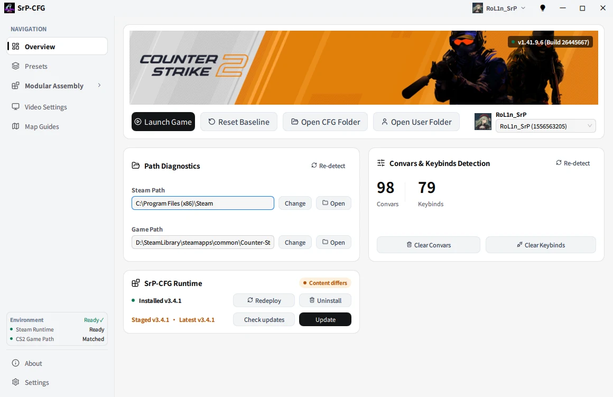
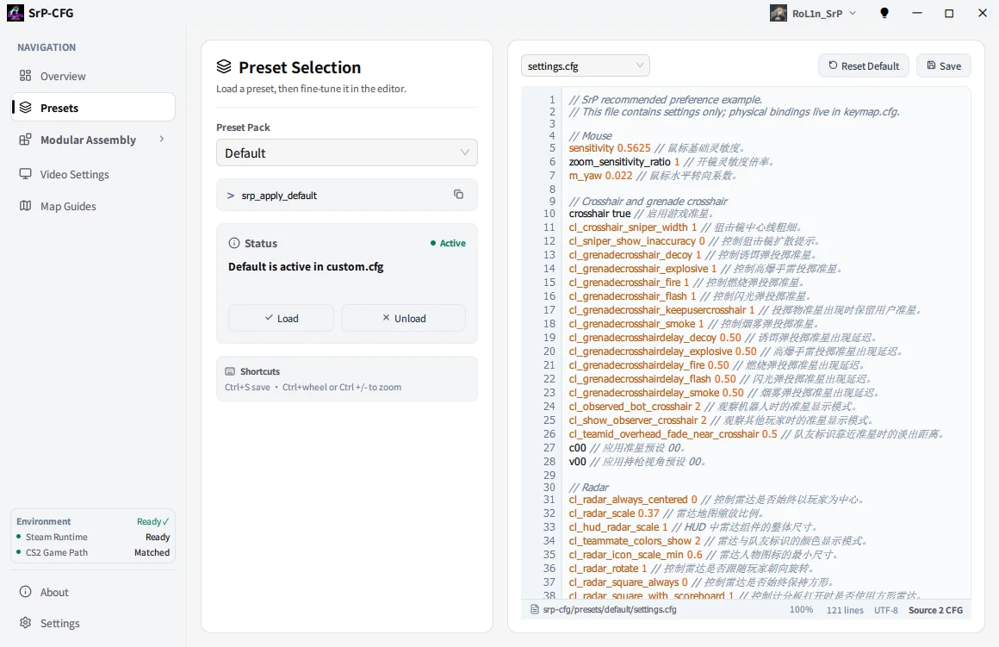
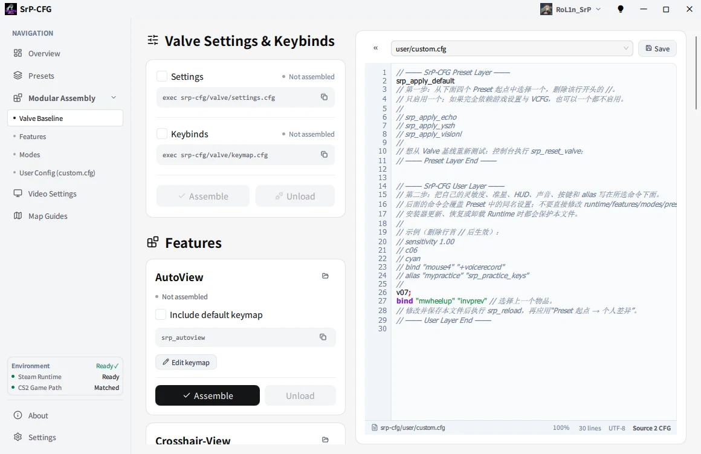
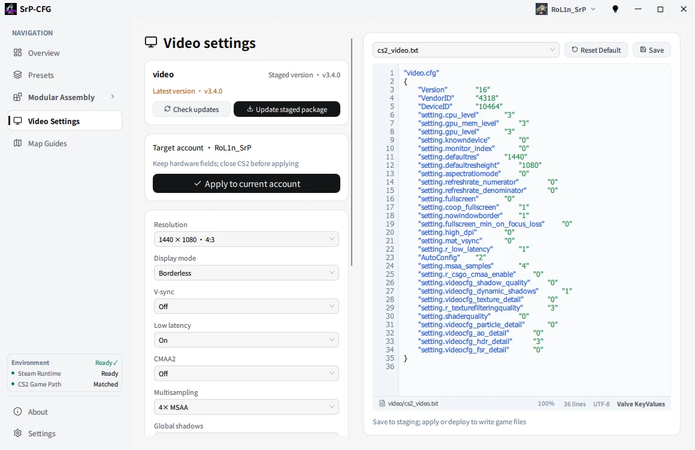
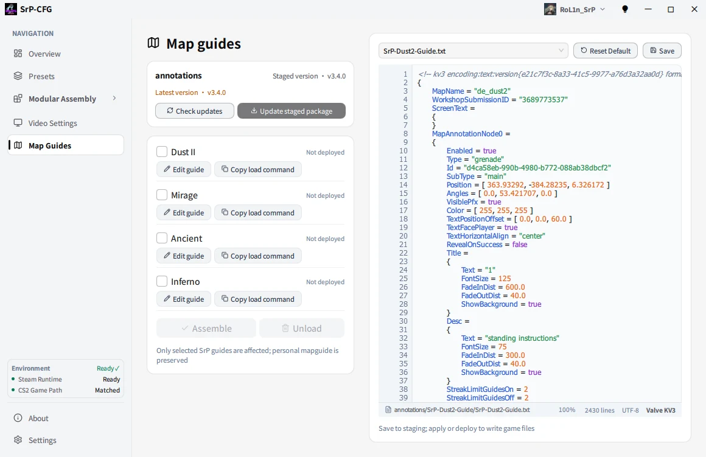
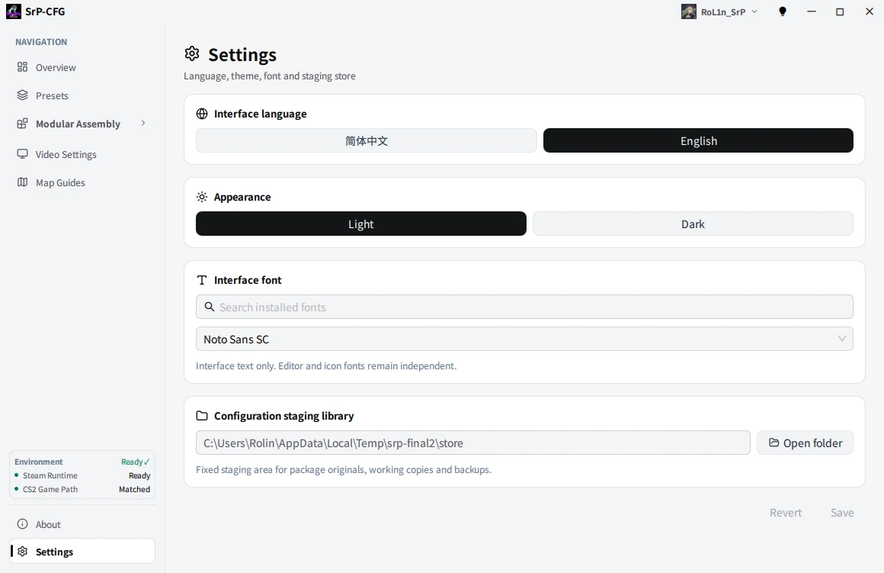
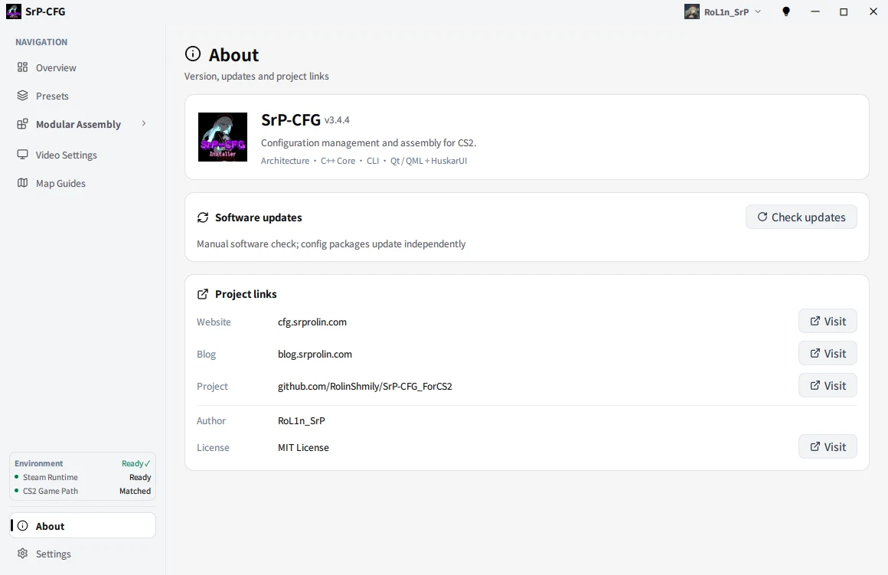
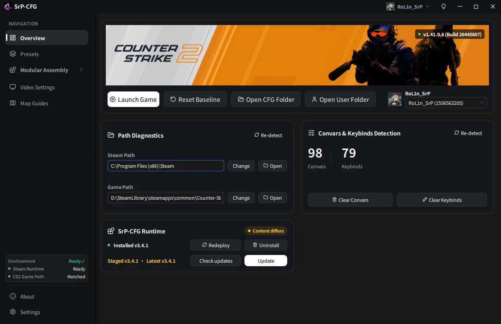

<h1 align="center">SrP-CFG</h1>

<p align="center">
  <b>English</b> | <a href="README.zh-CN.md">简体中文</a>
</p>

<p align="center">
  <a href="https://github.com/RolinShmily/SrP-CFG_ForCS2/actions/workflows/test.yml"></a>
  <a href="https://github.com/RolinShmily/SrP-CFG_ForCS2/releases"></a>
  <a href="https://github.com/RolinShmily/SrP-CFG_ForCS2/releases"></a>
  <a href="https://cfg.srprolin.com"></a>
  
  <a href="LICENSE"></a>
</p>

<p align="center">
  
</p>

<details>
<summary>More screenshots · presets, assembly, video, annotations, settings, about, dark mode</summary>

- **Presets**: 
- **Modular Assembly**: 
- **Video Settings**: 
- **Map Annotations**: 
- **Settings / About / Dark Mode**:   

</details>

**SrP-CFG** is a modular Counter-Strike 2 content suite (`content/`) paired with a Windows Qt 6 desktop package manager and safe editor, plus an online **CS2 Console Reference** at [`cfg.srprolin.com/console`](https://cfg.srprolin.com/console/).

- **Modular & Reversible**: Assemble presets, feature modules, and key-bound modes on demand without overwriting personal keybinds or `user/custom.cfg`.
- **Built-in Package Manager**: Manages `srp-cfg`, `video`, and `annotations` via an `Original / Work` staging store—update content packages without losing local edits, with up to 20 deduplicated `.bak` backups before every write.
- **Pure Native CS2 Files**: Zero DLL injection, zero memory modification, zero hooks—only native `.cfg`, `cs2_video.txt`, and KV3 map guides.
- **Companion `/console` Reference**: Search bilingual CS2 ConVars, Commands, categories, and flags at [`cfg.srprolin.com/console`](https://cfg.srprolin.com/console/) when writing your own `custom.cfg`.

## Usage

### 1. Download & Launch

Download `setup.exe` (installer) or `gui.zip` (portable) from [GitHub Releases](https://github.com/RolinShmily/SrP-CFG_ForCS2/releases) or [cfg.srprolin.com](https://cfg.srprolin.com/). Launch **SrP-CFG**—it automatically detects Steam, CS2, and your Steam accounts.

### 2. Assemble & Customize in the App

1. **Overview**: Click install/initialize to deploy the `srp-cfg` runtime into `game/csgo/cfg/` (updates and uninstalls preserve `user/custom.cfg`).
2. **Presets / Modular Assembly**: Pick a starting preset, or enable individual features (AutoView, Crosshair-View, Knife, Zeus) and bind launch keys for session modes (Practice, Preview, Demo, GuideMake).
3. **Video Settings & Map Annotations**: Tune `cs2_video.txt` while CS2 is closed (hardware IDs are preserved) and deploy native KV3 map guides (Ancient, Dust2, Inferno, Mirage).
4. **Personal Overrides**: Edit `user/custom.cfg` in the built-in syntax-highlighted editor; check [`cfg.srprolin.com/console`](https://cfg.srprolin.com/console/) whenever you need ConVar names or defaults.

### 3. Use In-Game

Add `+exec autoexec` to CS2's Steam launch options (or run `exec autoexec` in the console). Most switches and keybinds are configured directly in the desktop app (every `.cfg` file also includes inline comments), so in-game you only need a few entry commands when needed:

```cfg
srp_reload                         // Reload autoexec and user/custom.cfg immediately
srp_practice / srp_practice_keys   // Enter offline practice mode (or press your bound mode key)
srp_preview  / srp_preview_keys    // Enter skin / weapon inspect preview mode
srp_demo     / srp_demo_keys       // Enter Demo / HLAE playback mode
annotation_load SrP-Mirage-Guide   // Load a deployed native map guide
```

> **Without the desktop app (or for CS:GO)**: Download standalone archives (`srp-cfg`, `video`, `annotations`, `srp-cfg-csgo`) from [cfg.srprolin.com](https://cfg.srprolin.com/) or [GitHub Releases](https://github.com/RolinShmily/SrP-CFG_ForCS2/releases) and extract them to the paths listed in [`docs/reference.md`](docs/reference.md).

## Documentation

| Document | Scope |
| :--- | :--- |
| [`docs/architecture.md`](docs/architecture.md) | Repository layers, 4-layer CFG model, staging transactions & `/console` pipeline |
| [`docs/design.md`](docs/design.md) | Product positioning, architectural rationale & key trade-offs |
| [`docs/reference.md`](docs/reference.md) | Content catalogs, full command list, GUI diagnostic flags & network contracts |
| [`docs/development.md`](docs/development.md) | Local build, test gates, extending `content/`, licensing & release workflows |

Also see [`THIRD_PARTY_NOTICES`](THIRD_PARTY_NOTICES) and [`CHANGELOG.md`](CHANGELOG.md).

## License

MIT — Copyright (c) 2025–2026 **RoL1n_SrP**. See [`LICENSE`](LICENSE) and [`THIRD_PARTY_NOTICES`](THIRD_PARTY_NOTICES).

*Counter-Strike, Counter-Strike 2, CS2, Steam, and Valve are registered trademarks of Valve Corporation. This project is an independent open-source tool and is not affiliated with or endorsed by Valve Corporation.*
