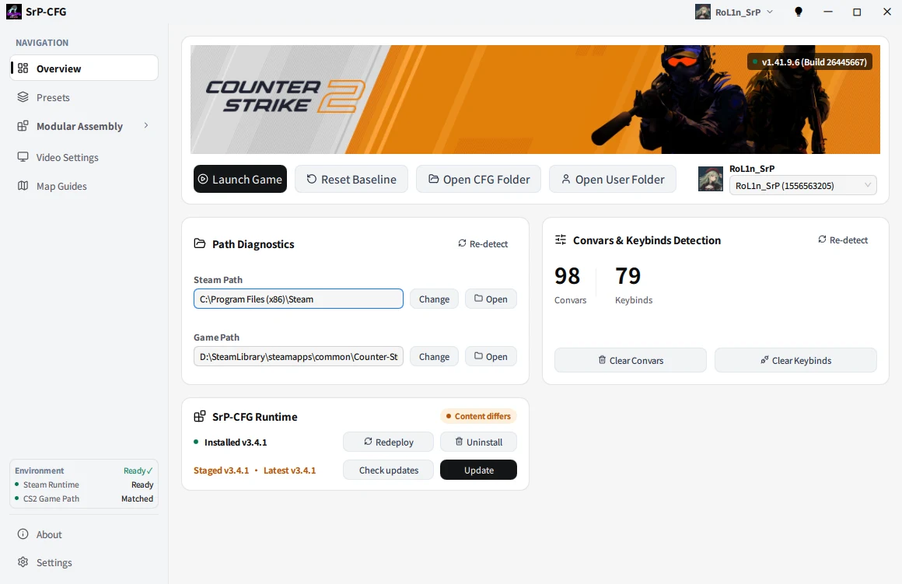
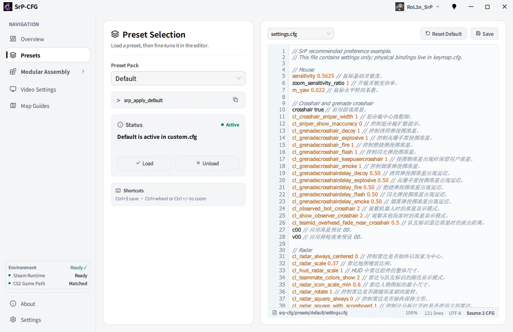
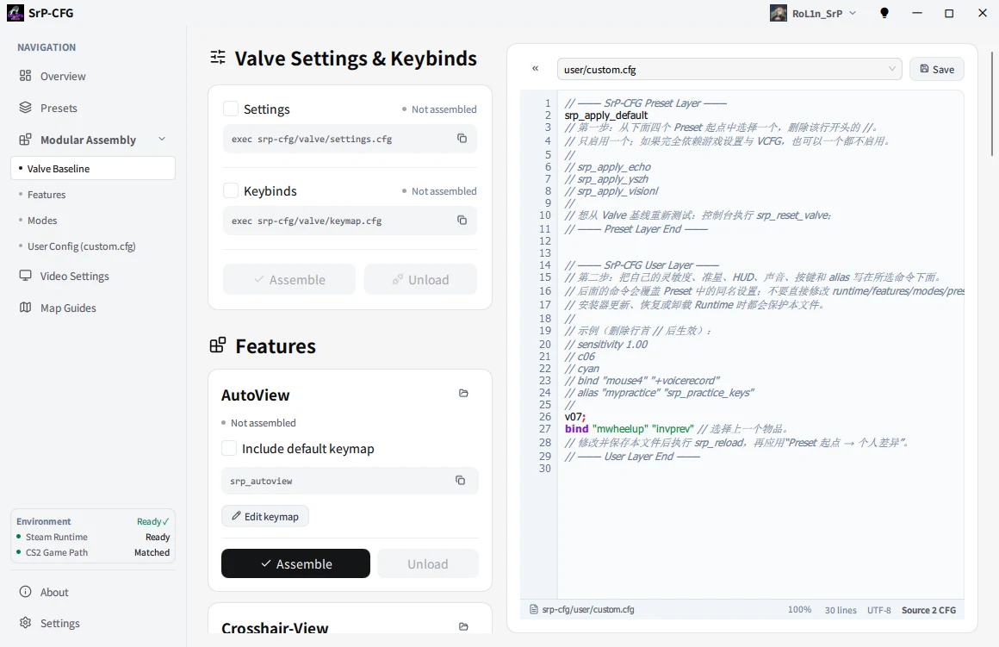
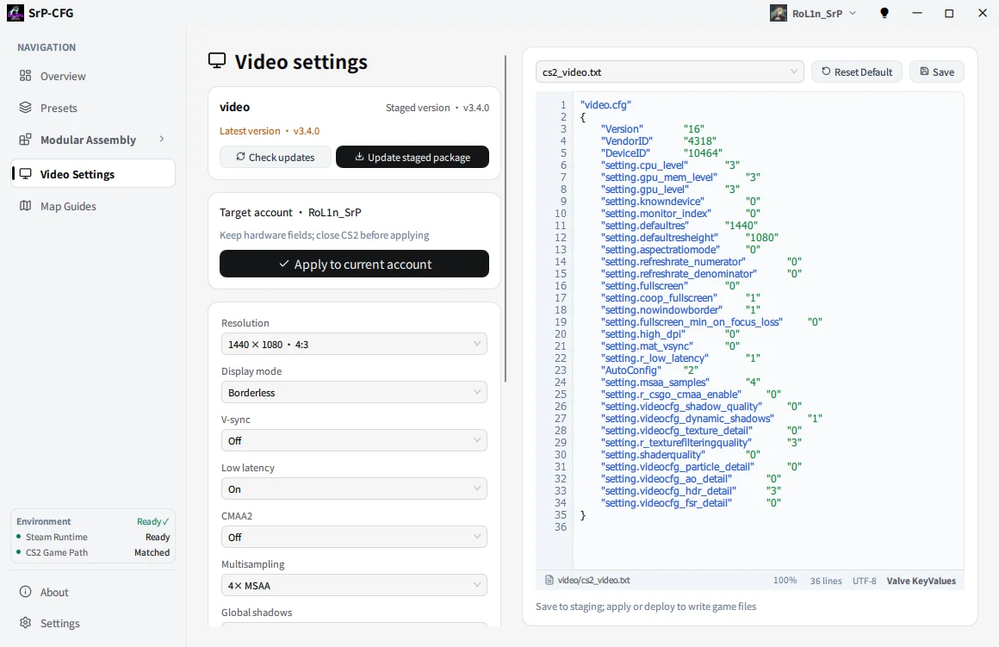
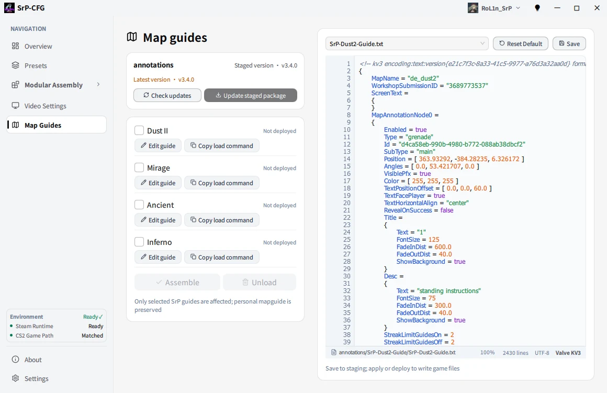
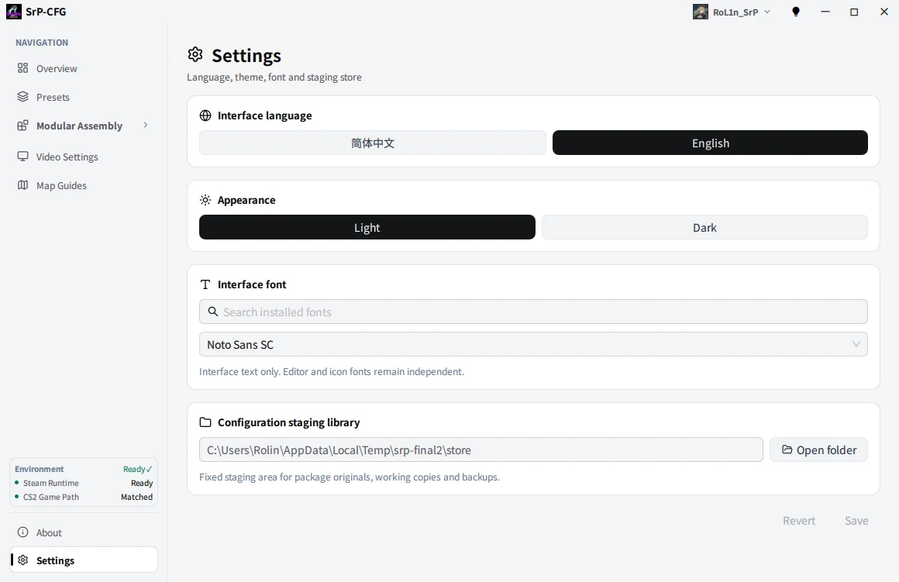
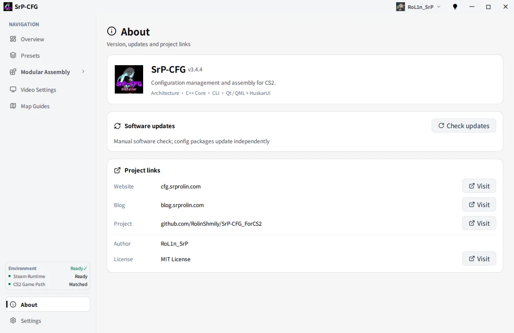
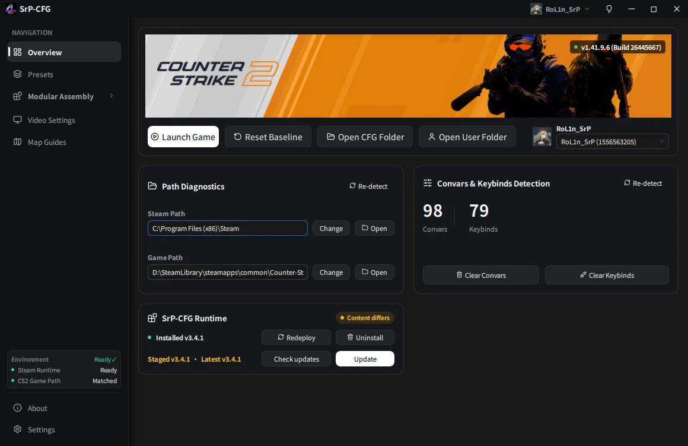

<h1 align="center">SrP-CFG</h1>

<p align="center">
  <a href="README.md">English</a> | <b>简体中文</b>
</p>

<p align="center">
  <a href="https://github.com/RolinShmily/SrP-CFG_ForCS2/actions/workflows/test.yml"></a>
  <a href="https://github.com/RolinShmily/SrP-CFG_ForCS2/releases"></a>
  <a href="https://github.com/RolinShmily/SrP-CFG_ForCS2/releases"></a>
  <a href="https://cfg.srprolin.com"></a>
  
  <a href="LICENSE"></a>
</p>

<p align="center">
  
</p>

<details>
<summary>更多截图 · 预设包、自由装配、视频设置、地图标注、设置、关于、深色模式</summary>

- **预设包**：
- **自由装配**：
- **视频设置**：
- **地图标注**：
- **设置 / 关于 / 深色模式**：  

</details>

**SrP-CFG** 是一套面向 Counter-Strike 2 的模块化配置内容套件（`content/`），搭配自带包管理器的 Windows Qt 6 桌面工作台与安全编辑器，并附带在线 **CS2 控制台指令参考站**（[`cfg.srprolin.com/console`](https://cfg.srprolin.com/console/)）。

- **模块化且可逆**：按需装配预设、功能模块与按键触发模式，不覆盖个人键位，物理隔离 `user/custom.cfg`。
- **内置内容包管理器**：通过 `Original / Work` 暂存区管理 `srp-cfg`、`video`、`annotations`，在线更新内容包时不丢失手工微调，每次写入前保留最多 20 份去重 `.bak` 备份。
- **纯原生 CS2 文件**：零 DLL 注入、零内存修改、零挂钩，仅操作原生 `.cfg`、`cs2_video.txt` 与 KV3 地图标注。
- **附加 `/console` 指令站**：写个人 `custom.cfg` 时可在 [`cfg.srprolin.com/console`](https://cfg.srprolin.com/console/) 按分类与标记检索中英文 ConVar / Command 说明并复制配置片段。

## 使用方法

### 1. 下载并启动

从 [GitHub Releases](https://github.com/RolinShmily/SrP-CFG_ForCS2/releases) 或官网 [cfg.srprolin.com](https://cfg.srprolin.com/) 下载安装版（`setup.exe`）或便携版（`gui.zip`），打开 **SrP-CFG** 后会自动识别 Steam、CS2 目录与当前账号。

### 2. 在桌面端装配与定制

1. **总览**：点击安装/初始化，将 `srp-cfg` 运行时部署到 `game/csgo/cfg/`（后续更新与卸载均保护 `user/custom.cfg`）。
2. **预设包 / 自由装配**：选择一套起步预设，或按需启用特性模块（AutoView、Crosshair-View、Knife、Zeus）并为练习/检视/Demo/制图等模式绑定启动键。
3. **视频设置与地图标注**：关闭 CS2 后在软件内调整并应用 `cs2_video.txt`（自动保留本机显卡与显示器标识），并按需部署原生地图标注指南（Ancient / Dust2 / Inferno / Mirage）。
4. **个人覆盖**：在内置语法高亮编辑器中直接编辑 `user/custom.cfg`；需要查参数含义或默认值时可查阅 [`cfg.srprolin.com/console`](https://cfg.srprolin.com/console/)。

### 3. 游戏内使用

在 Steam 的 CS2 启动项中加入 `+exec autoexec`（或在游戏控制台手动执行 `exec autoexec`）。日常开关与按键可在桌面端直接装配查看（每个 `.cfg` 文件内也都有中文注释），游戏内按需使用少量入口指令即可：

```cfg
srp_reload                         // 立即重新加载 autoexec 与 user/custom.cfg
srp_practice / srp_practice_keys   // 进入离线跑图练习模式（或直接按绑定的模式启动键）
srp_preview  / srp_preview_keys    // 进入皮肤 / 武器检视预览环境
srp_demo     / srp_demo_keys       // 进入 Demo / HLAE 录像回放模式
annotation_load SrP-Mirage-Guide   // 加载已部署的原生地图标注指南
```

> **不使用桌面端（或用于 CS:GO）**：可直接从 [cfg.srprolin.com](https://cfg.srprolin.com/) 或 [GitHub Releases](https://github.com/RolinShmily/SrP-CFG_ForCS2/releases) 下载独立内容包（`srp-cfg`、`video`、`annotations`、`srp-cfg-csgo`），按 [`docs/reference.md`](docs/reference.md) 中的目标路径解压即可。

## 文档

| 文档 | 内容范围 |
| :--- | :--- |
| [`docs/architecture.md`](docs/architecture.md) | 仓库分层契约、四层 CFG 模型、暂存区事务与 `/console` 数据管线 |
| [`docs/design.md`](docs/design.md) | 产品定位、架构取舍与核心设计思路 |
| [`docs/reference.md`](docs/reference.md) | 内容包清单协议、完整指令表、桌面端诊断参数与网络契约 |
| [`docs/development.md`](docs/development.md) | 本地编译、测试门禁、扩展 `content/`、许可证与发布工作流 |

另见 [`THIRD_PARTY_NOTICES`](THIRD_PARTY_NOTICES) 与 [`CHANGELOG.md`](CHANGELOG.md)。

## 开源许可证

本项目基于 **[MIT License](LICENSE)** 开源发布，Copyright (c) 2025–2026 **RoL1n_SrP**。第三方组件许可详见 [`THIRD_PARTY_NOTICES`](THIRD_PARTY_NOTICES)。

*Counter-Strike, Counter-Strike 2, CS2, Steam, Valve 均为 Valve Corporation 的注册商标。本项目为独立开源工具，与 Valve Corporation 没有任何关联或官方背书。*
